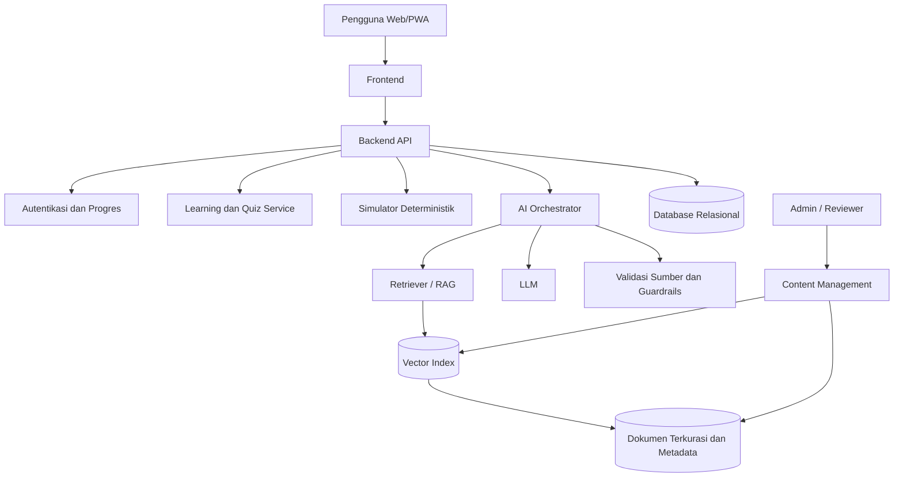

# Product Requirements Document (PRD)
# SYARIAH-AI — Platform Edukasi dan Asisten Keuangan Syariah Berbasis AI

| Informasi | Detail |
|---|---|
| Nama produk | SYARIAH-AI |
| Tagline | Smart Islamic Financial Education |
| Versi dokumen | 1.0 |
| Status | Draft konsep / usulan MVP |
| Tanggal | 26 Oktober 2026 |
| Penanggung jawab | Tim pengembang SYARIAH-AI (usulan) |
| Platform awal | Responsive Web App / PWA |
| Target awal | Mahasiswa dan Generasi Z di Indonesia |
| Konteks | Konsep inovasi untuk lomba esai: *Inovasi Teknologi Keuangan Syariah untuk Meningkatkan Inklusi dan Literasi Keuangan Masyarakat* |

> **Catatan:** Seluruh fitur dalam dokumen ini merupakan **rencana produk**, bukan klaim bahwa aplikasi telah dibangun atau diuji. SYARIAH-AI adalah platform **edukasi**, bukan penyedia layanan keuangan, penasihat investasi personal, atau lembaga pemberi fatwa.

---

## 1. Ringkasan Eksekutif

SYARIAH-AI adalah platform pembelajaran keuangan syariah yang menggabungkan asisten percakapan AI, basis pengetahuan terkurasi dengan *Retrieval-Augmented Generation* (RAG), modul pembelajaran adaptif, simulasi perhitungan, dan gamifikasi. Platform ini dirancang untuk membantu pengguna memahami konsep keuangan syariah, berlatih melalui skenario nyata, dan mengukur perkembangan literasi mereka.

**Nilai utama:** pengguna dapat *bertanya → memperoleh jawaban beserta sumber → mempraktikkan pemahaman melalui simulasi → mengikuti kuis → melihat perkembangan belajar* dalam satu aplikasi.

**Prioritas MVP:** (1) AI Syariah Assistant dengan sumber terverifikasi, (2) Smart Learning + kuis dasar, (3) Smart Financial Simulator untuk bagi hasil mudharabah dan estimasi zakat mal, (4) pengukuran literasi pre-test/post-test. Gamifikasi ringan digunakan untuk meningkatkan keterlibatan.

## 2. Latar Belakang dan Masalah

### 2.1 Permasalahan

- Istilah seperti *mudharabah, murabahah, nisbah, gharar,* dan *maysir* dapat sulit dipahami pemula tanpa contoh kontekstual.
- Materi edukasi tersebar di banyak sumber dan belum tentu mudah digunakan sebagai panduan belajar bertahap.
- Pengguna perlu membedakan penjelasan edukatif, simulasi hipotetis, dan ketentuan produk keuangan yang nyata.
- Pembelajaran pasif belum tentu menunjukkan peningkatan pemahaman yang terukur.

> Permasalahan di atas adalah **hipotesis produk** yang perlu divalidasi melalui wawancara pengguna dan data sekunder resmi. Jangan menyajikannya sebagai temuan survei aktual tanpa bukti.

### 2.2 Peluang

- Antarmuka percakapan dapat menurunkan hambatan pengguna untuk bertanya.
- RAG dapat menautkan jawaban ke dokumen rujukan yang diseleksi dan diperbarui.
- Simulasi interaktif dapat menjelaskan konsep yang abstrak.
- Pre-test dan post-test memungkinkan dampak edukasi diukur.

## 3. Tujuan dan Indikator Keberhasilan

### 3.1 Tujuan Produk

1. Meningkatkan pemahaman keuangan syariah pada pengguna pemula.
2. Memberikan penjelasan yang mudah diakses dan dapat ditelusuri sumbernya.
3. Menghadirkan latihan dan simulasi keuangan syariah yang transparan.
4. Mengukur pertumbuhan literasi, bukan sekadar jumlah kunjungan.

### 3.2 KPI Pilot (Target Hipotesis, Bukan Hasil Aktual)

| Indikator | Definisi operasional | Target awal pilot |
|---|---|---|
| Peningkatan literasi | Rata-rata skor post-test dikurangi pre-test (skala 0–100) | ≥ 15 poin persentase |
| Penyelesaian modul | Persentase peserta yang menuntaskan modul wajib | ≥ 60% |
| Jawaban AI didukung referensi | Persentase jawaban substantif yang memuat rujukan relevan | ≥ 95% |
| Ketepatan jawaban AI | Penilaian sampel jawaban oleh reviewer materi | ≥ 90% |
| Task completion simulator | Peserta berhasil menyelesaikan skenario tanpa bantuan | ≥ 80% |
| Kepuasan penggunaan | Nilai survei setelah pilot (skala 1–5) | ≥ 4,0/5 |

Target harus ditinjau ulang setelah studi dasar. Tidak boleh mengklaim dampak kausal hanya dari pre-test/post-test tanpa mempertimbangkan desain evaluasi.

## 4. Target Pengguna dan Persona

### 4.1 Pengguna Primer

- Mahasiswa usia sekitar 18–25 tahun yang ingin memahami dasar keuangan syariah.
- Generasi Z yang sedang belajar menabung, mengelola keuangan, dan memahami risiko produk keuangan.

### 4.2 Pengguna Sekunder (Pasca-MVP)

- Pengajar atau komunitas literasi keuangan.
- Masyarakat umum dan pelaku UMKM yang membutuhkan materi pengantar, setelah ada penelitian kebutuhan dan penyesuaian konten.

### 4.3 Persona Contoh (Fiktif)

**Alya, 21 tahun, mahasiswa:** ingin memahami akad tabungan syariah tetapi sering bingung dengan istilah teknis. Ia ingin bertanya lewat chat, membaca contoh sederhana, mengerjakan latihan, lalu mengecek pemahamannya.

**Rafi, 23 tahun, pekerja pemula:** ingin memahami perhitungan bagi hasil dan zakat dalam skenario edukatif serta mengetahui rujukan resmi yang bisa ia telaah sendiri.

## 5. Ruang Lingkup

### 5.1 Termasuk dalam MVP (P0)

1. Akun pengguna dan/atau mode belajar tanpa akun dengan keterbatasan penyimpanan progres.
2. Onboarding singkat serta pre-test.
3. Chatbot AI edukasi dengan RAG dan referensi sumber yang dapat dibuka.
4. Modul pembelajaran dasar dan kuis dengan umpan balik.
5. Simulator bagi hasil mudharabah dan estimasi zakat mal.
6. Dashboard progres dan post-test.
7. Pengelolaan materi dan versi sumber oleh admin/reviewer.
8. Kebijakan privasi, kontrol data, serta moderasi jawaban berisiko.

### 5.2 Fitur Lanjutan (P1)

- Gamifikasi lengkap: level, XP, badge, dan misi harian.
- Rekomendasi materi adaptif berdasarkan kekeliruan pengguna.
- *Syariah Product Explorer* berbasis sumber resmi.
- Mode aksesibilitas, audio, unduhan materi, dan dukungan koneksi rendah.
- Dashboard analitik agregat untuk pengajar/pengelola.

### 5.3 Di Luar Ruang Lingkup MVP

- Transaksi atau penyimpanan dana pengguna.
- Pembukaan rekening, pembelian investasi, pengajuan pembiayaan.
- Prediksi keuntungan atau rekomendasi investasi personal.
- Penetapan fatwa, sertifikasi halal, atau kepastian kepatuhan produk tertentu.
- Integrasi rekening bank atau akses data transaksi nyata.

## 6. User Journey Utama

1. Pengguna membuka aplikasi dan memilih tujuan belajar.
2. Pengguna menyelesaikan pre-test singkat.
3. Dashboard menampilkan modul dasar yang disarankan.
4. Pengguna membaca materi dan bertanya melalui AI Assistant.
5. AI menyajikan jawaban dengan referensi dan batasan bila belum yakin.
6. Pengguna mencoba simulator pada contoh kasus.
7. Pengguna mengerjakan kuis dan memperoleh umpan balik.
8. Pengguna mengikuti post-test dan melihat perkembangan belajar.

## 7. Kebutuhan Fungsional

### FR-01 — Onboarding, Akun, dan Profil Belajar (P0)

**Deskripsi:** pengguna dapat memulai belajar, menentukan tingkat pengetahuan awal, dan menyimpan progres jika membuat akun.

**Kriteria penerimaan:**
- Pengguna dapat memulai onboarding dalam ≤ 3 langkah utama.
- Pengguna diberi penjelasan sebelum data progres disimpan.
- Mode tamu dapat melihat materi publik; penyimpanan progres lintas perangkat memerlukan akun.
- Pengguna dapat meminta penghapusan akun/data sesuai kebijakan yang berlaku.

### FR-02 — AI Syariah Assistant Berbasis RAG (P0)

**Deskripsi:** asisten menjawab pertanyaan edukasi keuangan syariah dalam Bahasa Indonesia dengan merujuk basis pengetahuan yang dikurasi.

**Alur:** pertanyaan → klasifikasi maksud dan risiko → pencarian dokumen relevan → penyusunan jawaban berbasis konteks → pemeriksaan kutipan/sumber → tampilkan jawaban dan rujukan.

**Kriteria penerimaan:**
- Jawaban substantif memuat judul sumber dan tautan/referensi dokumen yang relevan apabila sumber tersedia.
- Jika sumber tidak memadai, asisten menyatakan keterbatasan dan menyarankan sumber resmi atau ahli.
- Sistem tidak mengklaim menerbitkan fatwa atau menjamin suatu produk halal.
- Pertanyaan tentang rekomendasi investasi personal dijawab sebagai informasi umum beserta risiko, bukan instruksi membeli.
- Pengguna dapat menandai jawaban sebagai tidak tepat; laporan masuk ke antrean review.

### FR-03 — Smart Learning (P0)

**Deskripsi:** materi disusun dari dasar ke lanjutan dalam bentuk teks ringkas, ilustrasi kasus, dan kuis.

**Contoh modul awal:** (1) Prinsip dasar keuangan syariah, (2) Pengantar akad, (3) Tabungan dan pembiayaan syariah, (4) Pengantar zakat, (5) Risiko dan keamanan layanan keuangan digital.

**Kriteria penerimaan:**
- Tiap modul mencantumkan tujuan belajar dan sumber.
- Setiap modul memiliki minimal 3 soal latihan dengan penjelasan jawabannya.
- Pengguna dapat melanjutkan dari progres terakhir.
- Materi harus disetujui reviewer sebelum dipublikasikan.

### FR-04 — Smart Financial Simulator (P0)

**Deskripsi:** simulasi edukatif yang mengubah input menjadi hasil perhitungan disertai asumsi.

**Simulator A: bagi hasil mudharabah (skenario laba)**
- Input: modal ilustratif, keuntungan usaha aktual/hipotetis, nisbah pemilik modal (%).
- Output: porsi laba pemilik modal = laba × nisbah; porsi pengelola = laba × (1 − nisbah).
- Validasi: laba ≥ 0; nisbah 0–100%; jika rugi, tampilkan materi terpisah mengenai aturan penanggungan kerugian dan peran kelalaian, bukan menggunakan rumus laba.
- Harus ditegaskan bahwa nisbah merupakan proporsi **laba**, bukan tingkat pengembalian tetap atas modal.

**Simulator B: estimasi zakat mal**
- Input: kategori dan nilai harta yang relevan; kewajiban yang diperbolehkan untuk diperhitungkan sesuai metode yang dipilih; status haul; nisab berdasarkan referensi yang berlaku.
- Output: estimasi zakat jika memenuhi persyaratan dan dasar perhitungan yang dijelaskan.
- Untuk contoh sederhana, angka 2,5% hanya diterapkan apabila syarat zakat terkait terpenuhi; jika data nisab/haul belum lengkap, sistem menampilkan simulasi hipotetis, **bukan kewajiban final**.
- Nilai acuan nisab perlu mempunyai sumber, tanggal berlaku, dan pengelolaan pembaruan.

**Kriteria penerimaan:**
- Input angka negatif ditolak atau ditangani jelas.
- Semua asumsi ditampilkan di dekat hasil.
- Pengguna dapat mengulang dan mereset simulasi.
- Perhitungan numerik dilakukan oleh fungsi deterministik yang diuji, bukan dihasilkan bebas oleh LLM.

### FR-05 — Kuis, Pre-test, dan Post-test (P0)

**Deskripsi:** pengguna menjawab soal konsep dan skenario praktis.

**Kriteria penerimaan:**
- Pre-test dan post-test memakai cakupan kompetensi yang setara.
- Skor dan pembahasan tersedia setelah pengerjaan.
- Dashboard menampilkan perubahan skor dan topik yang perlu dipelajari.
- Sistem menyimpan waktu, versi soal, dan hasil secara aman untuk analisis agregat.

### FR-06 — Dashboard Progres (P0)

**Deskripsi:** halaman utama menampilkan modul, progres, skor, dan saran langkah berikutnya.

**Kriteria penerimaan:**
- Progres modul diperbarui setelah kuis diselesaikan.
- Nilai contoh atau demo diberi label **ilustrasi** dan tidak ditampilkan sebagai hasil nyata pengguna.
- Dashboard mudah dibaca pada layar ponsel.

### FR-07 — Gamifikasi / Syariah Quest (P1; XP dasar dapat P0)

**Deskripsi:** poin pengalaman, badge, streak, dan tantangan belajar untuk meningkatkan motivasi.

**Kriteria penerimaan:**
- Poin diberikan berdasarkan aktivitas belajar yang sah, bukan tindakan transaksi.
- Hadiah tidak berupa janji imbal hasil finansial.
- Pengguna dapat belajar tanpa wajib mengikuti leaderboard.

### FR-08 — Syariah Product Explorer (P1)

**Deskripsi:** katalog **edukatif** konsep produk keuangan syariah dan aspek yang perlu diperiksa pengguna.

**Kriteria penerimaan:**
- Membedakan tipe produk, akad, potensi biaya, dan risiko.
- Mengarahkan verifikasi izin/pengawasan ke sumber resmi, tanpa menyatakan status terbaru bila belum diperiksa.
- Informasi diberi tanggal peninjauan terakhir.
- Tidak ada label "pasti halal" atau "tanpa risiko" yang dibuat otomatis oleh AI.

### FR-09 — Inclusive Learning Mode (P1)

**Deskripsi:** aksesibilitas teks, audio, bahasa sederhana, dan unduhan modul tertentu.

**Kriteria penerimaan:**
- Teks dapat diperbesar, kontrol dapat dipakai dengan keyboard, dan warna cukup kontras.
- Materi yang didukung dapat dibaca di koneksi rendah; jawaban AI tetap membutuhkan konektivitas kecuali ada model lokal terpisah.
- Pengguna dapat menyalakan/nonaktifkan audio.

### FR-10 — Literacy Analytics (P0 dasar; P1 lanjutan)

**Deskripsi:** pengukuran progres individual dan pelaporan agregat untuk evaluasi pilot.

**Kriteria penerimaan:**
- Menampilkan perubahan skor, penyelesaian modul, dan kebutuhan materi penguatan.
- Laporan admin menggunakan data agregat/pseudonim seperlunya.
- Ada penjelasan tentang batasan interpretasi hasil evaluasi.

### FR-11 — Admin dan Kurasi Konten (P0)

**Deskripsi:** reviewer dapat menambah, merevisi, menyetujui, dan menarik materi maupun referensi dari basis pengetahuan.

**Kriteria penerimaan:**
- Setiap sumber memiliki judul, penerbit, URL/identitas dokumen, tanggal publikasi (jika ada), tanggal akses/validasi, dan versi.
- Materi berstatus draf/review/terbit/arsip.
- Perubahan dicatat di audit log.
- Dokumen yang ditarik dari publikasi tidak lagi dipakai dalam jawaban baru setelah indeks diperbarui.

## 8. Kebutuhan Nonfungsional

| ID | Aspek | Target desain awal |
|---|---|---|
| NFR-01 | Responsif | Berfungsi baik di ponsel dan desktop modern |
| NFR-02 | Performa | P95 halaman konten utama ≤ 3 detik pada kondisi uji yang ditetapkan; jawaban AI memberi indikator proses |
| NFR-03 | Ketersediaan | Target pilot uptime ≥ 99% (di luar perawatan terjadwal) |
| NFR-04 | Keamanan | HTTPS, kontrol akses berbasis peran, sanitasi input, pembatasan permintaan, dan logging aman |
| NFR-05 | Privasi | Minimasi data pribadi, persetujuan jelas, retensi terbatas, opsi ekspor/hapus data |
| NFR-06 | Aksesibilitas | Mengacu WCAG 2.2 AA sejauh lingkup MVP memungkinkan; lakukan audit aksesibilitas |
| NFR-07 | Observabilitas | Metrik latensi, error, rujukan gagal, dan feedback jawaban tersedia untuk admin |
| NFR-08 | Keandalan hitungan | Unit test untuk formula keuangan serta pengecekan asumsi dan rentang input |
| NFR-09 | Keamanan AI | Proteksi prompt injection, pembatasan dokumen tidak tepercaya, dan evaluasi halusinasi |

Angka target di atas adalah **sasaran engineering awal**, bukan performa aplikasi yang telah diukur.

## 9. Arsitektur Sistem (Usulan)



### 9.1 Rekomendasi Stack (Dapat Disesuaikan)

- **Frontend:** Next.js / React, TypeScript, Tailwind CSS.
- **Backend:** Python FastAPI atau Node.js.
- **Database:** PostgreSQL untuk akun, progres, materi, hasil kuis, dan metadata dokumen.
- **RAG:** embeddings + vector index (mis. pgvector) dan retriever yang mempertahankan metadata sumber.
- **AI:** LLM yang dipilih melalui evaluasi kualitas Bahasa Indonesia, biaya, privasi, dan kemudahan integrasi.
- **Calculation Engine:** fungsi backend deterministik, terpisah dari model generatif.
- **Deployment:** layanan cloud yang mendukung HTTPS, pencadangan, pemantauan, dan pembatasan akses.

Pilihan vendor maupun framework belum diputuskan; ini bukan kewajiban memakai penyedia tertentu.

### 9.2 Alur Jawaban AI

1. Terima pertanyaan dan klasifikasikan apakah termasuk edukasi, hitungan, atau permintaan nasihat personal.
2. Ambil potongan referensi relevan dari indeks yang telah disetujui reviewer.
3. Susun jawaban dengan rujukan dan penanda ketidakpastian; jangan memperlakukan isi dokumen sebagai instruksi sistem.
4. Untuk perhitungan, kirim input ke simulator deterministik, bukan meminta LLM menghitung secara bebas.
5. Tampilkan jawaban, asumsi, sumber, dan opsi laporan kesalahan.
6. Simpan metadata audit seperlunya tanpa merekam informasi sensitif yang tidak diperlukan.

## 10. Model Data Inti (Konseptual)

| Entitas | Kolom inti | Keterangan |
|---|---|---|
| User | id, auth_id, preferences, created_at | Minimalkan data identitas |
| Module | id, title, level, status, version | Materi pembelajaran |
| Lesson | id, module_id, content, source_refs | Unit materi |
| Question | id, competency, prompt, options, answer, version | Butir penilaian |
| Assessment | id, user_id, type, score, timestamp | Pre/post-test dan kuis |
| LearningProgress | user_id, lesson_id, completed_at | Status pembelajaran |
| SourceDocument | id, publisher, title, url, version, reviewed_at, status | Metadata rujukan |
| ChatFeedback | id, user_id_optional, message_ref, rating, reason | Pelaporan kualitas AI |
| SimulationEvent | id, type, anonymized_metrics, timestamp | Analisis penggunaan tanpa wajib menyimpan data finansial rinci |

## 11. UX / Struktur Halaman

```text
SYARIAH-AI
├── Beranda / Dashboard
│   ├── Progres & rekomendasi modul
│   └── Mulai belajar / lanjutkan
├── Tanya AI
│   ├── Percakapan
│   └── Sumber dan feedback
├── Belajar
│   ├── Daftar modul
│   ├── Materi
│   └── Kuis
├── Simulasi
│   ├── Bagi Hasil Mudharabah
│   └── Estimasi Zakat Mal
├── Hasil Belajar
│   ├── Pre-test / Post-test
│   └── Riwayat progres
└── Profil & Privasi
    ├── Pengaturan aksesibilitas
    └── Kelola data
```

### Prinsip Desain

- **Mobile-first**, bahasa Indonesia yang jelas, dan istilah syariah disertai glosarium.
- Warna hijau dapat digunakan sebagai identitas visual, dengan rasio kontras yang memadai.
- Setiap hasil simulasi diberi konteks, bukan hanya nominal.
- Tautan sumber ditempatkan dekat klaim yang didukung.
- Hindari antarmuka yang memberi kesan aplikasi telah disahkan oleh regulator bila belum ada kemitraan resmi.

## 12. Konten, Kepatuhan, dan Keamanan Pengguna

1. **Sumber:** utamakan referensi terbitan otoritas/regulator dan lembaga terkait, misalnya OJK, Bank Indonesia, DSN-MUI, serta sumber zakat resmi yang relevan. Materi diberi metadata dan diverifikasi reviewer.
2. **Batasan AI:** AI menjelaskan konsep, **tidak menetapkan fatwa**, tidak menjamin kepatuhan syariah suatu produk, dan tidak memberikan rekomendasi investasi personal.
3. **Tinjauan ahli:** materi akad, zakat, dan klaim syariah memerlukan reviewer kompeten sebelum rilis.
4. **Privasi:** jangan meminta nomor rekening, PIN, kata sandi, NIK, atau informasi keuangan sensitif untuk proses belajar dasar. Jika pengguna mengirimnya, sistem perlu mengurangi paparan data tersebut.
5. **Transparansi:** gunakan label “simulasi edukasi”; tampilkan sumber dan tanggal peninjauan materi.
6. **Regulasi:** sebelum peluncuran nyata, lakukan telaah hukum terkait perlindungan data pribadi, layanan elektronik, konten edukasi keuangan, dan penggunaan istilah/identitas lembaga.
7. **Keamanan AI:** uji prompt injection, kutipan palsu, pertanyaan ambigu, dan permintaan saran finansial yang berisiko.

## 13. Prioritas Pengembangan

| Prioritas | Fitur | Alasan |
|---|---|---|
| P0 | RAG Assistant dengan sitasi | Diferensiasi utama; menjawab kebutuhan belajar |
| P0 | Modul dasar + kuis | Menyediakan kurikulum terstruktur |
| P0 | Simulator mudharabah + zakat | Mempraktikkan konsep dalam skenario |
| P0 | Pre/post-test dan progres | Mengukur dampak literasi |
| P0 | Admin kurasi + keamanan dasar | Mengurangi risiko jawaban keliru |
| P1 | Gamifikasi lanjutan | Memperkuat retensi belajar |
| P1 | Rekomendasi pembelajaran adaptif | Personalisasi setelah tersedia data pilot |
| P1 | Product Explorer | Memperluas literasi produk |
| P1 | Aksesibilitas/audio/offline lanjutan | Memperluas jangkauan |
| P2 | Integrasi komunitas/pengajar | Skalabilitas edukasi |

## 14. Roadmap Implementasi (Estimasi Perencanaan)

| Fase | Fokus | Deliverable |
|---|---|---|
| 0 — Validasi kebutuhan | Wawancara pengguna, telaah sumber, persetujuan konsep oleh reviewer | Personas tervalidasi, daftar kompetensi, daftar sumber |
| 1 — Desain produk | User flow, wireframe, desain UI, model konten | Prototipe interaktif dan spesifikasi final MVP |
| 2 — MVP | Modul, kuis, RAG Assistant, dua simulator, dashboard | Web MVP siap uji internal |
| 3 — Uji pilot | Pengujian akurasi, keamanan, usability, pre/post-test | Laporan hasil pilot dan backlog perbaikan |
| 4 — Iterasi | Gamifikasi, adaptasi materi, inklusivitas | Rilis lanjutan berbasis bukti pilot |

Durasi dan biaya belum ditetapkan; perlu estimasi setelah pembagian peran, pilihan teknologi, dan volume konten disepakati.

## 15. Pengujian dan Kriteria Rilis MVP

### 15.1 Skenario Pengujian Wajib

- **Rujukan:** tanyakan konsep akad; pastikan rujukan relevan dan dapat dibuka.
- **Tidak ada sumber:** tanyakan kasus spesifik tanpa referensi; AI harus menyatakan keterbatasan.
- **Prompt injection:** masukkan instruksi berbahaya dalam teks pertanyaan atau dokumen referensi; sistem tidak boleh menuruti instruksi yang melanggar kebijakan.
- **Hitungan:** bagi hasil dengan laba Rp1.000.000 dan nisbah 45:55 menghasilkan Rp450.000 dan Rp550.000.
- **Kasus negatif:** laba negatif tidak otomatis diproses dengan formula pembagian keuntungan.
- **Zakat:** jika belum ada informasi nisab/haul, UI tidak menyatakan nominal sebagai kewajiban final.
- **Privasi:** penghapusan data pengguna berjalan menurut ketentuan retensi.
- **Aksesibilitas:** navigasi keyboard dan pembaca layar diuji pada alur inti.
- **Pre/post-test:** hasil tersimpan dengan identitas soal/versi yang benar.

### 15.2 Definition of Done

- Seluruh fitur P0 lulus pengujian fungsional dan keamanan dasar.
- Materi dan contoh simulasi lolos peninjauan konten.
- Pertanyaan berisiko memiliki penanganan yang diuji.
- Pilot dapat mencatat KPI tanpa mengambil data pribadi berlebihan.
- Ada informasi publik tentang batasan AI, privasi, dan status platform sebagai edukasi.

## 16. Risiko dan Mitigasi

| Risiko | Dampak | Mitigasi |
|---|---|---|
| Halusinasi atau salah kutip AI | Mispersepsi prinsip syariah | RAG terkurasi, validasi rujukan, review ahli, mekanisme abstain |
| Sumber sudah tidak berlaku | Informasi usang | Versi sumber, tanggal review, proses pembaruan indeks |
| Simulasi disalahpahami sebagai nasihat | Keputusan finansial yang keliru | Disclaimer kontekstual, penjelasan asumsi dan risiko |
| Privasi pengguna | Kebocoran data | Minimasi data, enkripsi, kontrol akses, retensi terbatas |
| Biaya layanan AI | Operasional tidak berkelanjutan | Rate limit, caching aman, evaluasi model lebih efisien |
| Pengguna kurang tertarik | Retensi rendah | Kuis singkat, gamifikasi, uji UX dengan pengguna nyata |
| Bias evaluasi pilot | Klaim dampak tidak akurat | Desain pengukuran jelas, sampel memadai, laporkan keterbatasan |

## 17. Ketergantungan dan Kebutuhan Tim

- **Product/Research:** validasi masalah, perumusan kompetensi belajar, desain pilot.
- **Frontend/UI UX:** web responsif dan aksesibilitas.
- **Backend/AI:** API, RAG, database, logging, simulator deterministik.
- **Subject-matter reviewer:** pemeriksaan konten keuangan syariah dan zakat.
- **QA/Security:** pengujian perhitungan, privasi, keselamatan jawaban AI.

### Ketergantungan Kritis

- Hak penggunaan dan pemutakhiran materi referensi.
- Ketersediaan reviewer yang kompeten.
- Anggaran komputasi dan infrastruktur.
- Persetujuan etika/privasi untuk pengumpulan data evaluasi pengguna bila diperlukan.

## 18. Pertanyaan Terbuka

1. Apakah MVP akan menggunakan login, atau dimulai sebagai aplikasi belajar tanpa akun?
2. Dokumen rujukan mana yang telah mendapat persetujuan untuk dimasukkan ke basis pengetahuan?
3. Siapa yang berwenang meninjau topik akad, zakat, dan konten syariah?
4. Berapa jumlah peserta pilot dan apa rancangan penilaiannya?
5. Apakah fokus awal hanya mahasiswa, atau juga kelompok lain setelah validasi?
6. Berapa batas anggaran API/LLM dan kebutuhan hosting?

## 19. Keterkaitan dengan Lomba Esai

**Tema:** Peran Generasi Muda dalam Mengembangkan Inovasi Keuangan Syariah di Era Digital.

**Subtema:** Inovasi Teknologi Keuangan Syariah untuk Meningkatkan Inklusi dan Literasi Keuangan Masyarakat.

**Usulan judul esai:**

> **SYARIAH-AI: Integrasi Artificial Intelligence, Retrieval-Augmented Generation, dan Gamifikasi sebagai Inovasi Literasi Keuangan Syariah Inklusif bagi Generasi Z**

**Poin argumentasi utama:**

- **Masalah:** akses edukasi yang mudah dipahami dan terukur perlu diperkuat; dukung dengan data resmi terkini ketika menulis esai.
- **Inovasi:** integrasi chatbot dengan rujukan terkurasi, simulator deterministik, pembelajaran adaptif, dan evaluasi literasi.
- **Peran generasi muda:** mahasiswa Informatika sebagai perancang solusi, penguji, dan penggerak kolaborasi dengan ahli syariah.
- **Kelayakan:** MVP berbasis web dapat dimulai dari lingkup modul terbatas dan diperluas berdasar pilot.
- **Dampak terukur:** perubahan skor pemahaman, penyelesaian modul, dan ketepatan informasi.

**Batas klaim esai:** jangan menyebut aplikasi sudah tersedia, kemitraan sudah terjalin, atau efektivitas terbukti sebelum ada bukti nyata.

---

## 20. Glosarium

- **AI / LLM:** model komputasi untuk memproses bahasa dan menghasilkan respons.
- **RAG:** metode yang mengambil informasi dari sumber terpilih untuk membantu membangun jawaban model.
- **MVP:** versi produk paling sederhana yang cukup untuk menguji nilai utamanya.
- **Akad:** perjanjian dengan ketentuan sesuai prinsip syariah.
- **Mudharabah:** kerja sama usaha dengan penyedia modal dan pengelola berdasarkan ketentuan akad.
- **Nisbah:** proporsi pembagian keuntungan yang disepakati.
- **Murabahah:** akad jual beli dengan pengungkapan biaya perolehan dan margin yang disepakati.
- **Pre-test / post-test:** pengukuran pengetahuan sebelum dan setelah pembelajaran.
- **P0/P1/P2:** prioritas wajib awal / lanjutan / masa depan.

**Status dokumen:** Draf PRD untuk diskusi, validasi, dan pengembangan prototipe SYARIAH-AI.
